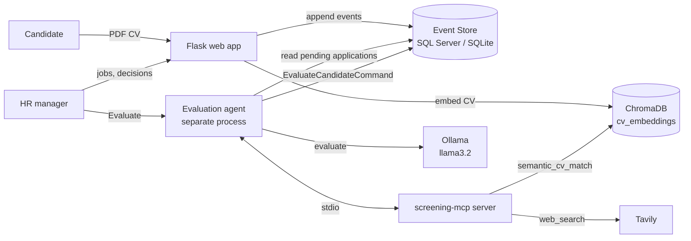

# Candidate Screening System

An AI-assisted hiring platform. HR posts roles, candidates apply with a PDF CV, and an independent evaluation agent judges each candidate against the job. It reads the CV through a vector database, checks industry context on the web, and writes a structured report that HR reads before making the final decision.

The project follows **Specification-Driven Application Development (SDAD)**. The specifications in [`requirements.md`](requirements.md), [`architecture.md`](architecture.md), and [`features.md`](features.md) come before the code and stay in sync with it.

---

## Table of contents

- [Demo](#-demo)
- [Features](#features)
- [How it works](#how-it-works)
- [Tech stack](#tech-stack)
- [Getting started](#getting-started)
- [Configuration](#configuration)
- [Using the app](#using-the-app)
- [Running the evaluation agent](#running-the-evaluation-agent)
- [Command reference](#command-reference)
- [Project structure](#project-structure)
- [Architecture](#architecture)
- [Testing](#testing)
- [Troubleshooting](#troubleshooting)
- [Project documents](#project-documents)
- [Support](#-support)
- [Authors](#-authors)

---

## 🎬 Demo

<!-- Replace the link below with your demo video (YouTube, Loom, or a GitHub upload). -->
▶️ **[Watch the demo video](https://example.com/your-demo-link)**

---

## Features

**For HR managers**
- Hiring dashboard with the number of open jobs and registered applicants.
- Create a job from a dialog, and close a job when it is filled.
- Expand any job or application in place with **View**, and collapse it again, without leaving the dashboard.
- Search jobs and applicants by title, requirement, name, email, or CV text.
- Open each candidate's original CV PDF in the browser.
- Start the evaluation agent from the dashboard for all pending applications, or for one job.
- Read the AI assessment: score, per-skill breakdown with CV evidence, strengths, weaknesses, missing information, a recommendation, and the web sources used.
- Accept or reject each candidate. The decision always belongs to HR, never to the agent.

**For candidates**
- See every open role with a short preview of its requirements.
- Apply once per role with a name and a PDF CV.
- See which roles you have already applied to.

**Under the hood**
- Event Sourcing: every change is an append-only event. Nothing is updated or deleted.
- Strict CQRS: commands only write events, queries only read and replay them.
- CV embeddings stored in ChromaDB for semantic matching.
- A Deep Agent evaluation process that runs separately from the web server.
- A project-owned MCP server that gives the agent web search (Tavily) and semantic CV matching.

---

## How it works



1. **A candidate applies.** The PDF's text is extracted and stored on an `ApplicationSubmitted` event. The original file is kept in `data/cvs/`.
2. **The CV is embedded.** After the event is saved, a projector turns the CV text into a vector with Ollama (`nomic-embed-text`) and stores it in ChromaDB.
3. **HR starts an evaluation.** The agent runs in its own process. For each application without an assessment, it:
   - compares the CV vector with the job requirements (`semantic_cv_match`),
   - searches the web for industry expectations and facts the CV names (`web_search`),
   - asks the model (`llama3.2`) for a structured JSON report,
   - validates that report and records it as a `CandidateEvaluated` event.
4. **HR decides.** HR reads the report and accepts or rejects the candidate, which records a `CandidateDecided` event.

If any evaluation step fails, nothing is recorded for that application and it is retried on the next run.

---

## Tech stack

| Area | Technology |
|---|---|
| Web app | Python, Flask, Jinja templates, plain CSS and JavaScript |
| Event store | SQL Server on Somee.com via `pyodbc`, or local SQLite |
| Vector database | ChromaDB |
| Models | Ollama in Docker: `llama3.2` for evaluation, `nomic-embed-text` for embeddings |
| Agent | Deep Agents (`deepagents`) with `langchain-ollama` |
| Tools | MCP server (`screening-mcp`) with Tavily web search |
| PDF parsing | `pypdf` |
| Tests | `pytest` |

---

## Getting started

### Prerequisites

- **Python 3.11 or newer**
- **Docker**, to run Ollama locally
- **A Tavily API key**, from [tavily.com](https://tavily.com), for the agent's web search
- *Optional:* **ODBC Driver 17 or 18 for SQL Server**, only if you use a Somee.com database instead of local SQLite

### 1. Clone the repository

```bash
git clone <repository-url>
cd cv-screening-ai-agent
```

### 2. Create a virtual environment and install dependencies

**Windows (PowerShell)**
```powershell
py -m venv .venv
.venv\Scripts\Activate.ps1
pip install -r requirements.txt
```

**macOS / Linux**
```bash
python3 -m venv .venv
source .venv/bin/activate
pip install -r requirements.txt
```

### 3. Start Ollama and pull the models

```bash
docker run -d --name ollama -p 11434:11434 -v ollama:/root/.ollama ollama/ollama
docker exec ollama ollama pull nomic-embed-text
docker exec ollama ollama pull llama3.2
```

Check that it is running by opening [http://localhost:11434](http://localhost:11434). It should say *Ollama is running*.

### 4. Create your `.env` file

**Windows (PowerShell)**
```powershell
Copy-Item .env.example .env
```

**macOS / Linux**
```bash
cp .env.example .env
```

Then open `.env` and set at least:

```ini
SECRET_KEY=<a long random string>
LLM_PROVIDER=ollama
TAVILY_API_KEY=<your Tavily key>
```

See [Configuration](#configuration) for every setting.

### 5. Run the web app

```bash
python run.py
```

Open [http://127.0.0.1:5000](http://127.0.0.1:5000). On first start, the event store table is created automatically. With an empty `DATABASE_URL`, events are saved to `data/event_store.sqlite`.

---

## Configuration

All settings are read from `.env` in the project root.

| Variable | Default | Description |
|---|---|---|
| `SECRET_KEY` | `dev-only-change-me` | Flask session secret. Always set your own. |
| `DATABASE_URL` | *(empty)* | Empty uses local SQLite at `data/event_store.sqlite`. For Somee.com, paste the connection string from the Somee panel or an ODBC string. |
| `HR_EMAIL` / `HR_PASSWORD` | `hr@example.com` / `changeme` | The HR login. |
| `CANDIDATE_EMAIL` / `CANDIDATE_PASSWORD` | `candidate@example.com` / `changeme` | The main candidate login. |
| `EXTRA_CANDIDATES` | *(empty)* | More candidate logins as `email:password` pairs, separated by commas. |
| `LLM_PROVIDER` | `ollama` | Set to `ollama`. |
| `OLLAMA_BASE_URL` | `http://localhost:11434` | Where Ollama is listening. |
| `OLLAMA_EMBED_MODEL` | `nomic-embed-text` | Model used for CV and requirement embeddings. |
| `OLLAMA_CHAT_MODEL` | `llama3.2` | Model used to write the evaluation report. |
| `VECTOR_DB_PATH` | `./data/vector_store` | Folder where ChromaDB stores its data. |
| `TAVILY_API_KEY` | *(empty)* | Tavily key. Read only by the `screening-mcp` server. Without it, evaluations fail and nothing is recorded. |

Example Somee.com connection string:

```ini
DATABASE_URL=data source=HOST;initial catalog=DATABASE;user id=USER;pwd=PASSWORD;TrustServerCertificate=True
```

---

## Using the app

### Sign in

Go to **Log in** and use one of the accounts from your `.env`. HR accounts land on the hiring dashboard. Candidate accounts land on the list of open positions.

### As a candidate

1. Open **Apply** to see every open role, with a short preview of its requirements.
2. Click **Apply** on a role. The page shows the full requirements next to the form.
3. Enter your full name and choose your **CV as a PDF** (5 MB or smaller, with selectable text, not a scanned image).
4. Click **Submit application**. You return to the list, and that role now shows **Applied**.

Your email comes from the account you signed in with. You can apply to each role once, and an application cannot be edited after it is sent.

### As HR

**Create a job.** Click **Create new job**, enter a title and the requirements, and click **Publish job**. Write the requirements as clear skills, for example *"3+ years of Python, Flask, REST APIs, teamwork"*. The agent scores each skill it finds there.

**Browse jobs and applicants.**
- **View** on a job expands its requirements and applicant list right on the dashboard. Click **Hide** to collapse it.
- **View** on an applicant expands the full application: CV link, requirements, AI assessment, and decision.
- **New tab** opens the same job or application on its own page.
- Click an applicant's **assessment badge** to see a short summary in a side panel.
- Click the CV link to open the candidate's original PDF.

**Search.** Type in the search box and click **Search**. A job matches on its title or requirements. An applicant matches on name, email, or CV text. Matching ignores capital letters and finds the text anywhere in the field. Click **Clear** to return to the full dashboard.

**Evaluate candidates.**
- **Evaluate pending** on the dashboard runs the agent for every open job that has applications without an assessment.
- **Evaluate** on a job runs the agent for that job only.

The agent opens in its own window and the page returns immediately. Refresh after it finishes to see the results. Only one evaluation can run at a time. The buttons are hidden when nothing is waiting.

**Read the assessment.** Each report shows:

| Field | Meaning |
|---|---|
| Status | **Recommended** or **Not recommended** |
| Score | Match score from 0 to 100 |
| Skill breakdown | Each required skill marked *met*, *partial*, or *missing*, with evidence from the CV |
| Strengths / Weaknesses | What fits the role and what does not |
| Missing information | What the CV does not show |
| Recommendation | A short conclusion for HR |
| Semantic match | Vector similarity between the CV and the requirements (0 to 1) |
| Sources | Web pages the agent used |

**Decide.** Click **Accept** or **Reject** on the application. The decision is final and shows who made it. You can decide before or after the assessment exists. The assessment never decides on its own.

**Close a job.** Click **Close** on the dashboard or **Close job** on the job page. A closed job disappears from the dashboard, the candidate list, and search. Its applicants can no longer be evaluated, but its page stays reachable by link.

---

## Running the evaluation agent

You can start the agent from the HR dashboard, or from a terminal in the project folder:

```bash
# Every open job with pending applications
python -m src.agents

# One job only
python -m src.agents --job-id <job_id>
```

The agent:
- runs as a separate process and never blocks the web app,
- starts the `screening-mcp` server itself, so you do not need to run it separately,
- skips applications that already have an assessment and applications for closed jobs,
- prints how many assessments it recorded when it finishes.

Make sure Ollama is running and `TAVILY_API_KEY` is set before you start it.

---

## Command reference

| Command | What it does |
|---|---|
| `python run.py` | Starts the web app at `http://127.0.0.1:5000`. |
| `python -m src.agents` | Evaluates every pending application for open jobs. |
| `python -m src.agents --job-id <id>` | Evaluates pending applications for one job. |
| `python -m src.projections` | Embeds any CV that is missing from ChromaDB. Reads events only. |
| `python -m src.mcp_server` | Starts the `screening-mcp` server over stdio. The agent normally does this for you. |
| `pytest` | Runs the test suite. |

---

## Project structure

```text
cv-screening-ai-agent/
├── run.py                     Web app entry point
├── requirements.txt           Python dependencies
├── .env.example               Configuration template
├── requirements.md            What the system must do
├── architecture.md            How the system is built
├── features.md                Feature-by-feature specification
├── rules.md / skills.md       Agent rules and skills
├── tests.md                   Test plan
├── src/
│   ├── __init__.py            App factory: wires commands, queries, and blueprints
│   ├── config.py              Settings from .env
│   ├── identity.py            HR and candidate accounts
│   ├── cv_pdf.py              PDF validation, text extraction, file storage
│   ├── controllers/           Flask routes (auth, home, candidate, hr)
│   ├── commands/              Write side: validate, then append events
│   ├── queries/               Read side: replay events into views
│   ├── persistence/           Append-only event store (SQL Server / SQLite)
│   ├── projections/           CV embeddings into ChromaDB
│   ├── providers/             Model access through LLMProvider (Ollama)
│   ├── agents/                Candidate evaluation agent and its launcher
│   ├── mcp_server/            screening-mcp: web_search and semantic_cv_match
│   ├── integrations/          MCP client used by the agent
│   ├── templates/             Jinja pages and partials
│   └── static/                CSS and JavaScript
├── tests/                     pytest suite
├── data/                      Local data, created at runtime (not committed)
│   ├── event_store.sqlite
│   ├── vector_store/
│   └── cvs/
└── .cursor/
    ├── rules/                 Project rule for the coding agent
    └── skills/                Custom and Skills.sh skills
```

---

## Architecture

### Event Sourcing

The database is an append-only log. Every change is a new event, and the current state is rebuilt by replaying them in order.

| Event | Recorded when |
|---|---|
| `JobCreated` | HR publishes a job |
| `JobClosed` | HR closes a job |
| `ApplicationSubmitted` | A candidate applies |
| `CandidateEvaluated` | The agent records an assessment |
| `CandidateDecided` | HR accepts or rejects |

No event row is ever updated or deleted. Closing a job, for example, adds a `JobClosed` event rather than changing the original job.

### CQRS

- **Commands** (`src/commands/`) validate input, reject bad input before touching the database, and only append events. They return success, a message, and a reference id, never domain data.
- **Queries** (`src/queries/`) only read events and rebuild the views the pages show. They never write.
- **Projections** (`src/projections/`) write CV vectors to ChromaDB, only after the event is committed.

### The evaluation agent

The agent's only write is `EvaluateCandidateCommand`. It reaches the outside world only through the `screening-mcp` tools:

| Tool | Input | Output |
|---|---|---|
| `web_search` | `query`, `max_results` (1 to 10) | A list of `{title, url, content}` from Tavily |
| `semantic_cv_match` | `application_id`, `requirements` | `{application_id, semantic_match}` from 0 to 1 |

Both tools are read-only. `screening-mcp` is the only process that holds the Tavily key. All model calls go through the `LLMProvider` interface in `src/providers/`.

For full details, see [`architecture.md`](architecture.md).

---

## Testing

```bash
pytest
```

The suite covers the event store, commands and their validation, queries and replay, authentication, PDF handling, CV embeddings, the MCP tools, the evaluation agent, the agent launcher, and HR decisions. Tests use temporary databases and do not touch your `data/` folder.

---

## Troubleshooting

**The evaluation finished but recorded 0 assessments.**
Check the agent's window for the error. The usual causes are Ollama not running, a model not pulled, or a missing `TAVILY_API_KEY`. Nothing is saved on failure, so fix the cause and run it again.

**"This PDF has no readable text."**
The PDF is probably a scanned image. Export the CV from Word or Google Docs as a PDF so it contains selectable text.

**"An evaluation is already running."**
Only one agent process runs at a time. Wait for its window to finish and close, then try again.

**The CV vector is missing, or semantic matching fails.**
Rebuild missing vectors from the stored applications:
```bash
python -m src.projections
```

**Cannot connect to Somee.com.**
Install ODBC Driver 17 or 18 for SQL Server and check the connection string. To work locally instead, leave `DATABASE_URL` empty.

**Ollama is not reachable.**
Run `docker ps` to confirm the `ollama` container is up, and check that `OLLAMA_BASE_URL` matches its port.

---

## Project documents

| Document | Contents |
|---|---|
| [`requirements.md`](requirements.md) | Functional and non-functional requirements |
| [`architecture.md`](architecture.md) | System design, patterns, and components |
| [`features.md`](features.md) | Each feature's events, rules, and behaviour |
| [`rules.md`](rules.md) | Rules that guide the agents |
| [`skills.md`](skills.md) | The evaluation skill workflow |
| [`tests.md`](tests.md) | Test plan |

---

## 📞 Support

- 🐛 **Found a bug?** [Open an issue](https://github.com/dinais/cv-screening-ai-agent/issues)
- 💡 **Have a feature request?** [Start a discussion](https://github.com/dinais/cv-screening-ai-agent/discussions)
- 📧 **Email:** [your-email@gmail.com](mailto:your-email@gmail.com) · [dinablack092@gmail.com](mailto:dinablack092@gmail.com)

---

## 👥 Authors

| | Name | GitHub |
|---|---|---|
| 👩‍💻 | **Bracha Rosenfeld** | [@your-github-username](https://github.com/your-github-username) |
| 👩‍💻 | **Dina Black** | [@dinais](https://github.com/dinais) |

---

<div align="center">

⭐ **Star this repo if it helped you!** ⭐

Made with ❤️ and lots of ☕

</div>
